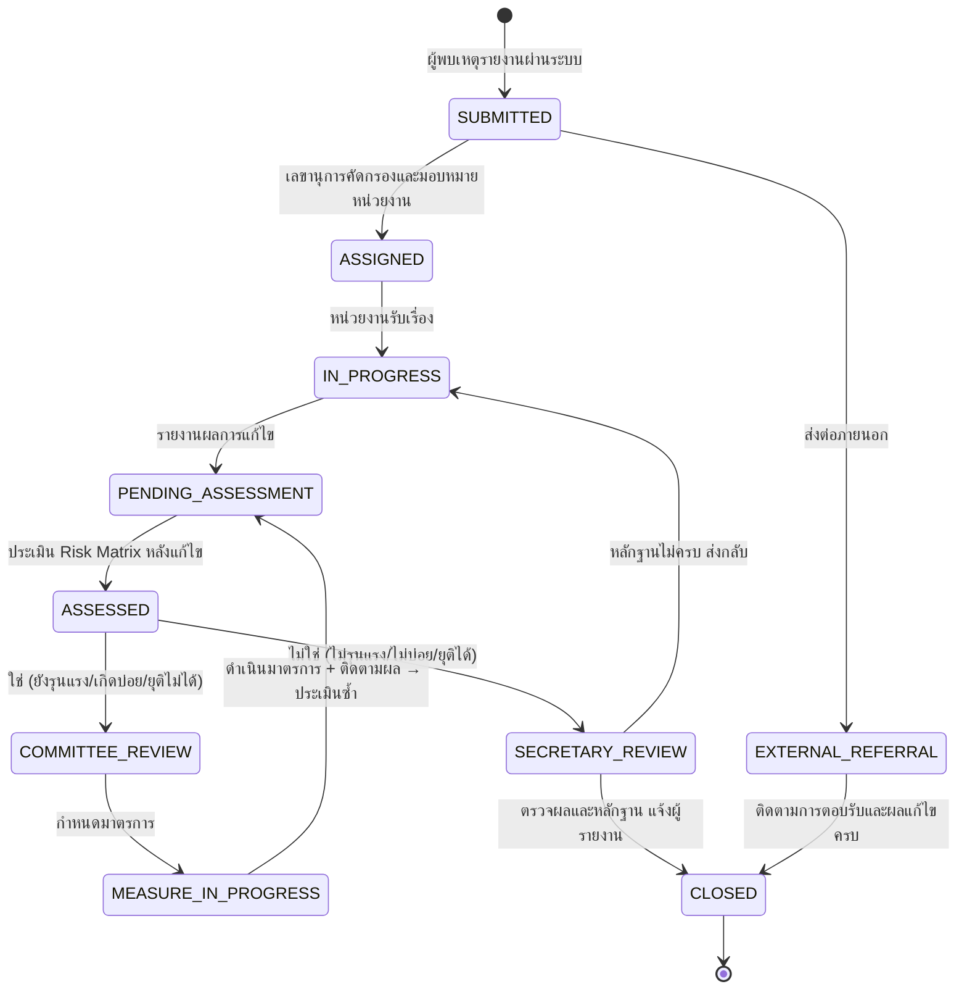

# ระบบรายงานและจัดการความเสี่ยงด้านการศึกษา (MEDUP Educational Risk)

เอกสารออกแบบระบบ อ้างอิงจาก [MEDUP_Educational_Risk_Flowchart.png](MEDUP_Educational_Risk_Flowchart.png)

> หลักการของ flowchart: **หน่วยงานแก้ไขก่อน แล้วจึงพิจารณามาตรการป้องกันการเกิดซ้ำ**

---

## 1. ขอบเขตและเป้าหมาย

- ให้ผู้พบเหตุรายงานความเสี่ยงด้านการศึกษาผ่านเว็บได้ง่าย พร้อมแนบหลักฐาน
- ให้เลขานุการคัดกรอง มอบหมายหน่วยงาน ติดตาม และปิดเรื่อง
- ให้หน่วยงานรายงานผลการแก้ไข และประเมิน Risk Matrix หลังแก้ไข
- ส่งเรื่องที่ยังรุนแรง / เกิดบ่อย / ยุติไม่ได้ เข้าคณะกรรมการ เพื่อกำหนดมาตรการ แล้ววนกลับไปประเมินซ้ำจนกว่าจะผ่าน
- รองรับกรณี **ส่งต่อภายนอก** และ **เหตุเร่งด่วน** ตามหมายเหตุท้าย flowchart
- เก็บประวัติทุกการเปลี่ยนสถานะ (audit trail) และมี dashboard สรุปภาพรวม

## 2. เทคโนโลยี (ตามที่ติดตั้งไว้ใน `package.json`)

| ส่วน | เลือกใช้ |
|---|---|
| Framework | Next.js 16 (App Router, Server Components, Server Actions) |
| UI | Ant Design 6 + Tailwind CSS 4, ไอคอน `lucide-react`, แจ้งเตือน `react-hot-toast` |
| ฐานข้อมูล | MariaDB ผ่าน Prisma 7 + `@prisma/adapter-mariadb` |
| Authentication | `next-auth` v4 (Credentials provider) + `bcrypt` |
| ป้องกัน route | `proxy.ts` (Next 16 เปลี่ยนชื่อจาก `middleware.ts` เป็น `proxy.ts` แล้ว) |

## 3. บทบาทผู้ใช้ (Roles)

| Role | หน้าที่ตาม flowchart | สิทธิ์หลัก |
|---|---|---|
| `REPORTER` | ผู้พบเหตุ (อาจารย์ นักศึกษา บุคลากร) | สร้างรายงาน, ดูเรื่องของตนเอง, รับแจ้งผล |
| `SECRETARY` | เลขานุการ | คัดกรอง, มอบหมาย, ส่งต่อภายนอก, ตรวจผลและหลักฐาน, ปิดเรื่อง, ดูทุกเรื่อง |
| `DEPT_STAFF` | หน่วยงานผู้รับผิดชอบ | รับเรื่อง, รายงานผลแก้ไข, ประเมิน Risk Matrix, ดำเนินมาตรการ (เฉพาะเรื่องของหน่วยงานตน) |
| `COMMITTEE` | คณะกรรมการ | พิจารณาและกำหนดมาตรการ |
| `ADMIN` | ผู้ดูแลระบบ | จัดการผู้ใช้ หน่วยงาน ค่าตั้งต้น |

ผู้ใช้หนึ่งคนมีได้หลาย role (เช่น หัวหน้าหน่วยงานที่เป็นกรรมการด้วย) และทุก role สร้างรายงานได้

## 4. Workflow และสถานะ (State Machine)

ขั้นตอนใน flowchart ถูกแปลงเป็นสถานะของเรื่อง (`ReportStatus`) ดังนี้



### ตารางการเปลี่ยนสถานะ (ใช้เป็น guard ในโค้ด)

| จาก | ไป | ผู้กระทำ | ข้อมูลที่ต้องกรอก |
|---|---|---|---|
| — | `SUBMITTED` | ทุก role | รายละเอียดเหตุการณ์, หมวดหมู่, วันที่เกิด, สถานที่/รายวิชา, ไฟล์แนบ, ธงเร่งด่วน |
| `SUBMITTED` | `ASSIGNED` | SECRETARY | หน่วยงานรับผิดชอบ (ตนเอง/ที่เกี่ยวข้อง), กำหนดเสร็จ, หมายเหตุคัดกรอง |
| `SUBMITTED` | `EXTERNAL_REFERRAL` | SECRETARY | หน่วยงานภายนอก, เลขหนังสือ, วันที่ส่ง |
| `ASSIGNED` | `IN_PROGRESS` | DEPT_STAFF | (กดรับเรื่อง) |
| `IN_PROGRESS` | `PENDING_ASSESSMENT` | DEPT_STAFF | สาเหตุ, การแก้ไขที่ทำ, หลักฐาน, ผลลัพธ์ `outcome` (`RESOLVED` / `UNRESOLVED`) |
| `PENDING_ASSESSMENT` | `ASSESSED` | DEPT_STAFF | โอกาสเกิด (1–5), ผลกระทบ (1–5), ความถี่ที่ผ่านมา |
| `ASSESSED` | `SECRETARY_REVIEW` / `COMMITTEE_REVIEW` | ระบบเสนอ, SECRETARY ยืนยัน | เหตุผลการตัดสิน (ดูข้อ 5) |
| `COMMITTEE_REVIEW` | `MEASURE_IN_PROGRESS` | COMMITTEE | มาตรการ (หลายข้อได้), ผู้รับผิดชอบ, กำหนดเสร็จ, ครั้งที่ประชุม |
| `MEASURE_IN_PROGRESS` | `PENDING_ASSESSMENT` | DEPT_STAFF | ผลการดำเนินมาตรการแต่ละข้อ + หลักฐาน |
| `SECRETARY_REVIEW` | `CLOSED` | SECRETARY | สรุปผล, ข้อความแจ้งผู้รายงาน |
| `SECRETARY_REVIEW` | `IN_PROGRESS` | SECRETARY | เหตุผลที่ส่งกลับ |
| `EXTERNAL_REFERRAL` | `CLOSED` | SECRETARY | วันที่ได้รับตอบ, ผลแก้ไขจากภายนอก |

ทุกการเปลี่ยนสถานะต้องผ่านฟังก์ชันเดียว `transition(reportId, to, actor, payload)` ใน `lib/workflow.ts` ซึ่ง
1. ตรวจว่า `from → to` อยู่ในตารางข้างบน และผู้กระทำมีสิทธิ์
2. บันทึกข้อมูลของขั้นนั้น + `StatusHistory` ใน transaction เดียวกัน
3. สร้าง `Notification` ให้ผู้เกี่ยวข้องขั้นถัดไป

### เหตุเร่งด่วน (Urgent)

- ผู้รายงานติ๊ก "เหตุเร่งด่วน" ได้ตอนสร้างรายงาน หรือเลขานุการตั้งภายหลัง
- เมื่อเป็นเร่งด่วน: แจ้งเตือนเลขานุการและหัวหน้าหน่วยงานที่เกี่ยวข้อง **ทันที** (in-app + email) แสดงเป็นแถบแดงบนสุดของทุกรายการ และ workflow ยังคงเดินตามปกติ (การช่วยเหลือหน้างานเกิดนอกระบบ ระบบบันทึกเวลาที่รับทราบ)

## 5. Risk Matrix และจุดตัดสินใจ

ประเมินแบบ 5×5: **คะแนน = โอกาสเกิด (Likelihood) × ผลกระทบ (Impact)**

| คะแนน | ระดับ | สี |
|---|---|---|
| 1–4 | ต่ำ (Low) | เขียว |
| 5–9 | ปานกลาง (Medium) | เหลือง |
| 10–16 | สูง (High) | ส้ม |
| 17–25 | สูงมาก (Extreme) | แดง |

**จุดตัดสินใจ "ยังรุนแรง เกิดบ่อย หรือยุติปัญหาไม่ได้?"** ระบบเสนอคำตอบ "ใช่" อัตโนมัติเมื่อเข้าเกณฑ์ข้อใดข้อหนึ่ง (OR 4 ข้อ)

| เกณฑ์ | ค่าเริ่มต้น | ความหมาย |
|---|---|---|
| `likelihood × impact` | ≥ 10 | คะแนน Risk Matrix ถึงเกณฑ์ (ระดับสูงขึ้นไป) |
| `impact` | ≥ 4 | ผลกระทบคงเหลือรุนแรง แม้โอกาสเกิดต่ำ |
| `likelihood` | ≥ 4 | มีโอกาสเกิดซ้ำบ่อย |
| `outcome === "UNRESOLVED"` | — | หน่วยงานสิ้นสุดการแก้ไขแต่ยุติปัญหาไม่ได้ |

เลขานุการยืนยันหรือเปลี่ยนคำตอบได้ แต่ต้องใส่เหตุผล ทุกการประเมินเก็บเป็นแถวใหม่ (`RiskAssessment.round`) เพื่อดูแนวโน้มความเสี่ยงหลังแต่ละรอบมาตรการ

> เกณฑ์ตัวเลขข้างบนเป็นค่าตั้งต้น เก็บไว้ในตาราง `Setting` ให้ ADMIN ปรับได้ ต้องยืนยันกับคณะกรรมการ (ดูข้อ 10)

## 6. โมเดลข้อมูล (Prisma / MariaDB)

```prisma
enum Role { REPORTER SECRETARY DEPT_STAFF COMMITTEE ADMIN }

enum ReportStatus {
  SUBMITTED ASSIGNED IN_PROGRESS PENDING_ASSESSMENT ASSESSED
  SECRETARY_REVIEW COMMITTEE_REVIEW MEASURE_IN_PROGRESS
  EXTERNAL_REFERRAL CLOSED
}

enum RiskLevel { LOW MEDIUM HIGH EXTREME }

enum ActionOutcome { RESOLVED UNRESOLVED }

model User {
  id           Int          @id @default(autoincrement())
  email        String       @unique
  passwordHash String
  name         String
  roles        UserRole[]
  departmentId Int?
  department   Department?  @relation(fields: [departmentId], references: [id])
  active       Boolean      @default(true)
  createdAt    DateTime     @default(now())
}

model UserRole {
  userId Int
  role   Role
  user   User @relation(fields: [userId], references: [id])
  @@id([userId, role])
}

model Department {
  id    Int    @id @default(autoincrement())
  code  String @unique
  name  String
  users User[]
}

model RiskCategory {            // เช่น หลักสูตร, การสอน, การวัดผล, การฝึกปฏิบัติ, สวัสดิภาพผู้เรียน
  id     Int     @id @default(autoincrement())
  name   String
  active Boolean @default(true)
}

model RiskReport {
  id             Int          @id @default(autoincrement())
  code           String       @unique          // ER-2569-0001
  title          String
  description    String       @db.Text
  categoryId     Int
  occurredAt     DateTime
  location       String?                       // สถานที่ / รายวิชา / ชั้นปี
  isUrgent       Boolean      @default(false)
  isAnonymous    Boolean      @default(false)  // ซ่อนตัวตนผู้รายงานจากหน่วยงาน
  status         ReportStatus @default(SUBMITTED)
  reporterId     Int
  departmentId   Int?                          // หน่วยงานที่ได้รับมอบหมาย
  dueDate        DateTime?
  screeningNote  String?      @db.Text
  closingSummary String?      @db.Text
  closedAt       DateTime?
  createdAt      DateTime     @default(now())
  updatedAt      DateTime     @updatedAt

  actions        ActionReport[]
  assessments    RiskAssessment[]
  decisions      CommitteeDecision[]
  referral       ExternalReferral?
  attachments    Attachment[]
  history        StatusHistory[]
  @@index([status])
  @@index([departmentId, status])
}

model ActionReport {            // ผลการแก้ไข (รอบแรก) หรือผลดำเนินมาตรการ (รอบถัดไป)
  id         Int      @id @default(autoincrement())
  reportId   Int
  round      Int                               // 1 = แก้ไขเบื้องต้น, 2+ = หลังมาตรการ
  rootCause  String?  @db.Text
  actionTaken String  @db.Text
  outcome    ActionOutcome
  createdById Int
  createdAt  DateTime @default(now())
}

model RiskAssessment {
  id           Int       @id @default(autoincrement())
  reportId     Int
  round        Int
  likelihood   Int                             // 1–5
  impact       Int                             // 1–5
  score        Int                             // likelihood × impact
  level        RiskLevel
  needsCommittee Boolean                       // คำตอบของจุดตัดสินใจ
  systemSuggested Boolean                      // ค่าที่ระบบเสนอ (เก็บไว้เทียบ)
  decisionReason String?  @db.Text
  assessedById Int
  confirmedById Int?                           // เลขานุการผู้ยืนยัน
  createdAt    DateTime  @default(now())
}

model CommitteeDecision {
  id          Int       @id @default(autoincrement())
  reportId    Int
  meetingRef  String?                          // ครั้งที่ประชุม
  summary     String    @db.Text
  measures    Measure[]
  decidedAt   DateTime  @default(now())
}

model Measure {
  id           Int       @id @default(autoincrement())
  decisionId   Int
  description  String    @db.Text
  departmentId Int
  dueDate      DateTime
  done         Boolean   @default(false)
  result       String?   @db.Text
}

model ExternalReferral {
  id           Int       @id @default(autoincrement())
  reportId     Int       @unique
  organization String
  letterNo     String?
  sentAt       DateTime
  respondedAt  DateTime?
  outcome      String?   @db.Text
}

model Attachment {
  id         Int      @id @default(autoincrement())
  reportId   Int
  stage      ReportStatus                      // แนบในขั้นไหน (หลักฐานตอนรายงาน/ตอนแก้ไข)
  fileName   String
  storageKey String
  mimeType   String
  size       Int
  uploadedById Int
  createdAt  DateTime @default(now())
}

model StatusHistory {           // audit trail ห้ามแก้/ลบ
  id        Int          @id @default(autoincrement())
  reportId  Int
  from      ReportStatus?
  to        ReportStatus
  actorId   Int
  note      String?      @db.Text
  createdAt DateTime     @default(now())
}

model Comment { id Int @id @default(autoincrement()) reportId Int authorId Int body String @db.Text internal Boolean @default(true) createdAt DateTime @default(now()) }
model Notification { id Int @id @default(autoincrement()) userId Int reportId Int? message String readAt DateTime? createdAt DateTime @default(now()) }
model Setting { key String @id value String }
```

(relation ที่เหลือละไว้เพื่อให้อ่านง่าย จะเติมครบตอนสร้าง `prisma/schema.prisma` จริง)

## 7. โครงสร้างหน้าเว็บ (App Router)

```
app/
  (auth)/login/page.tsx
  (app)/layout.tsx                     # Sidebar + Header (antd Layout) ตาม role
  (app)/dashboard/page.tsx             # สรุปตามสถานะ, heatmap risk matrix, เรื่องเกินกำหนด, เรื่องเร่งด่วน
  (app)/reports/new/page.tsx           # ฟอร์มรายงาน (ทุก role)
  (app)/reports/page.tsx               # รายการเรื่อง + filter (สถานะ/หน่วยงาน/หมวด/ระดับ/ช่วงเวลา)
  (app)/reports/[id]/page.tsx          # รายละเอียด + timeline + แผง "สิ่งที่ต้องทำ" ตามสถานะและ role
  (app)/my-reports/page.tsx            # เรื่องที่ฉันรายงาน (REPORTER)
  (app)/inbox/page.tsx                 # งานรอดำเนินการของฉัน (คัดกรอง/รับเรื่อง/ประเมิน/พิจารณา)
  (app)/committee/page.tsx             # วาระเรื่องรอพิจารณา
  (app)/admin/{users,departments,categories,settings}/page.tsx
  api/auth/[...nextauth]/route.ts
  api/attachments/[id]/route.ts        # ดาวน์โหลดไฟล์ พร้อมตรวจสิทธิ์
lib/
  prisma.ts          # PrismaClient + PrismaMariaDb adapter (singleton)
  auth.ts            # authOptions, getCurrentUser(), requireRole()
  workflow.ts        # ตาราง transition + transition()
  risk.ts            # calcScore(), levelOf(), suggestNeedsCommittee()
  notify.ts          # in-app + email
actions/             # Server Actions ต่อขั้น: submitReport, assignReport, acceptReport, ...
proxy.ts             # redirect ผู้ที่ยังไม่ login ออกจาก (app)
```

หน้า `reports/[id]` เป็นหัวใจของระบบ: แสดง stepper ตาม flowchart (ขั้นปัจจุบันไฮไลต์) timeline จาก `StatusHistory` และฟอร์มของขั้นถัดไปเฉพาะเมื่อผู้ใช้มีสิทธิ์ทำขั้นนั้น

## 8. ความปลอดภัยและความเป็นส่วนตัว

- ตรวจสิทธิ์ใน Server Action / Route Handler ทุกครั้ง (`proxy.ts` เป็นแค่ด่านแรก ไม่ใช่ด่านเดียว)
- DEPT_STAFF เห็นเฉพาะเรื่องที่มอบหมายให้หน่วยงานตน, REPORTER เห็นเฉพาะเรื่องของตน
- เรื่องที่ `isAnonymous` ไม่ส่งชื่อผู้รายงานไปหน่วยงาน/กรรมการ (เห็นได้เฉพาะเลขานุการ)
- ไฟล์แนบเก็บนอก `public/` ดาวน์โหลดผ่าน route ที่ตรวจสิทธิ์ จำกัดชนิดและขนาดไฟล์
- `StatusHistory` เป็น append-only
- รหัสผ่าน hash ด้วย bcrypt; `.env` เก็บ `DATABASE_URL`, `NEXTAUTH_SECRET`, ค่า SMTP

## 9. ลำดับการพัฒนา (Milestones)

1. **พื้นฐาน** — Prisma schema + migration + seed (role, หน่วยงาน, หมวด), login, layout ตาม role
2. **รายงานและคัดกรอง** — ฟอร์มรายงาน, แนบไฟล์, คัดกรอง/มอบหมาย, ส่งต่อภายนอก, ธงเร่งด่วน
3. **หน่วยงานแก้ไข + Risk Matrix** — รับเรื่อง, รายงานผล, ประเมิน, จุดตัดสินใจ
4. **ปิดเรื่อง / คณะกรรมการ** — ตรวจหลักฐานและปิดเรื่อง, วาระกรรมการ, มาตรการ, วงจรประเมินซ้ำ
5. **Dashboard + แจ้งเตือน** — สรุปสถิติ, heatmap, เรื่องเกินกำหนด, email
6. **ทดสอบ** — unit test ของ `workflow.ts` และ `risk.ts` ครอบคลุมทุกเส้นทางใน flowchart

## 10. ประเด็นที่ต้องยืนยันกับผู้ใช้งาน

1. ค่าเกณฑ์ทั้ง 4 ข้อของจุดตัดสินใจ (ค่าตั้งต้นในข้อ 5)
2. อนุญาตการรายงานแบบไม่ระบุตัวตนหรือไม่ และต้อง login ก่อนรายงานหรือไม่
3. เลขานุการปฏิเสธ/รวมเรื่องซ้ำตั้งแต่ขั้นคัดกรองได้หรือไม่ (flowchart ไม่ได้ระบุ)
4. ระยะเวลา (SLA) ของแต่ละขั้น เช่น คัดกรองภายในกี่วัน แก้ไขภายในกี่วัน
5. วงจร "ประเมินซ้ำ" มีจำนวนรอบสูงสุดหรือไม่ และใครยืนยันคำตอบที่จุดตัดสินใจ (เลขานุการหรือกรรมการ)
6. การ login ใช้บัญชีในระบบเอง หรือเชื่อมกับระบบบัญชีขององค์กร (LDAP / SSO)
